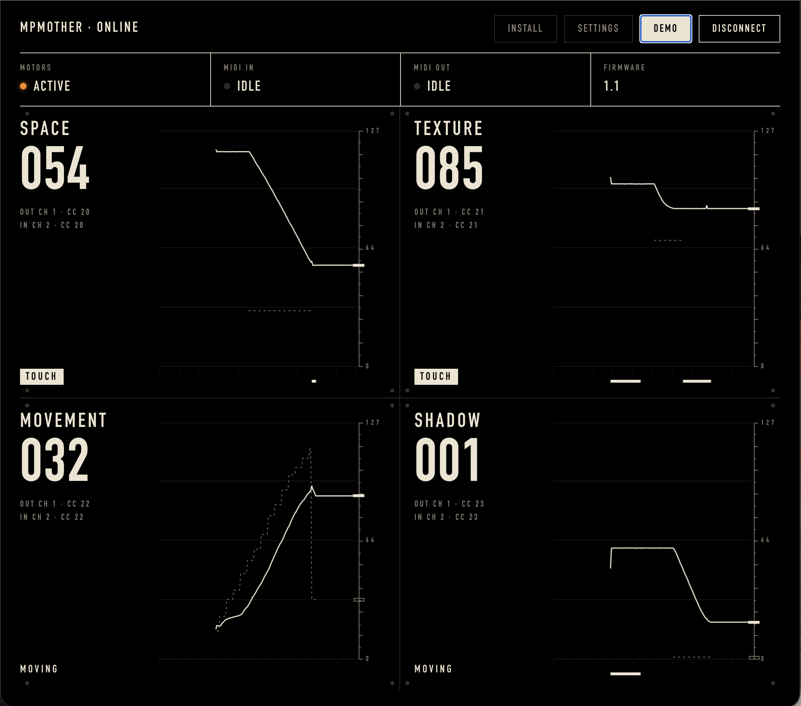

# MPMOTHER

House of North 2026

| Knob | Name     | MIDI Out (default) | MIDI In (default) |
|------|----------|--------------------|-------------------|
| 1    | SPACE    | ch 1, CC 20        | ch 2, CC 20       |
| 2    | TEXTURE  | ch 1, CC 21        | ch 2, CC 21       |
| 3    | MOVEMENT | ch 1, CC 22        | ch 2, CC 22       |
| 4    | SHADOW   | ch 1, CC 23        | ch 2, CC 23       |

MIDI Out is what a knob sends, MIDI In is what moves it. Every knob has its own channel and CC
for both, set in the config tool.

## Using it with Ableton Live

- **Map a knob:** MIDI-map a parameter to the knob as usual.
- **Knobs follow the set:** in Live's MIDI preferences, turn on *Remote* for the MPMOTHER
  **output**. Live then sends mapping feedback and the knobs jump to the right place.
- **Let Ableton drive the knobs:** send ch 2, CC 20–23 to MPMOTHER from a MIDI track
  (clips, automation, Max for Live LFOs). The knobs move and send their position.
- A hand on a knob always wins.

## Config tool

Open <https://houseofnorth.github.io/mpmother/> in Chrome or Edge with the controller plugged in.
The first time, Chrome asks for permission to use MIDI devices: click **Allow**, the page needs it.
The main page shows the four knobs live (position, where the motor is heading, hand on knob).
**Settings** (top right) has all settings, calibration, wiper readings and faults.
It works while Ableton is running.

**As an app, offline:** click **Install** (top right; or the install icon in Chrome's address bar).
MPMOTHER then opens in its own window from the Dock / Start menu and works without internet.
It updates itself whenever it is opened online.

**Demo** (top right): with the controller connected, the knobs make random moves until you
press Demo again. Without a controller it shows a simulated one.

## Status LED

| Colour          | Meaning |
|-----------------|---------|
| dim green       | ready |
| blue flicker    | MIDI in or out |
| red blink       | fault, motors held off |
| solid red       | driver kept faulting, needs *Clear faults* or a power cycle |
| white blink ×3  | restarted by the watchdog |

## Hardware

A main board (MPMOTHER v1) and one pot board (MPCHILD v1) per knob. Schematic, board file,
Gerbers and pictures: [hardware/](hardware/).

## Firmware

PlatformIO project. Open this folder in VS Code with the PlatformIO extension, then
*Build* (✓) and *Upload* (→). Serial monitor at 115200 – type `help` for text commands.

First time on new hardware: run **Calibrate** (config tool or `calibrate`), hands off the knobs.

Code layout and tuning values are explained at the top of each file in `src/`.
SysEx details: [PROTOCOL.md](PROTOCOL.md).
